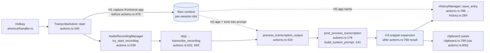

# Fork architecture: Handy → private dictation app

Status: step 0 (foundation). Owner: Architect. Base: `cjpais/Handy` @ `7bfb2e2` (v0.9.8).
Line numbers refer to that commit; re-check them after each upstream sync.

## 1. Build and test record

Environment: Apple M3 Max, macOS 26.6.2, CMake 4.4.4 (Homebrew), rustc/cargo 1.99.1, Bun 1.4.4.
Recorded 2026-10-27 on a cold cache (no `~/.cargo` registry or `node_modules` beforehand).

```bash
# prefix for every shell
source ~/.cargo/env; export PATH="$HOME/.bun/bin:$PATH"
export CMAKE_POLICY_VERSION_MINIMUM=3.5   # set preemptively for CMake 4.x; not tested without it
export HANDY_DISABLE_UPDATER=1            # always: never self-update from cjpais' feed (section 5)
```

| Step               | Command                                                                      | Result                                                                                                                        | Duration                                                     |
| ------------------ | ---------------------------------------------------------------------------- | ----------------------------------------------------------------------------------------------------------------------------- | ------------------------------------------------------------ |
| VAD model          | already present at `src-tauri/resources/models/silero-vad-v6.2-F32.gguf`     | ok                                                                                                                            | n/a                                                          |
| JS deps            | `bun install`                                                                | ok, 350 packages                                                                                                              | 687 s (slow network, not CPU)                                |
| Frontend build     | `bun run build`                                                              | ok (Vite chunk-size warning only)                                                                                             | 12 s                                                         |
| Lint               | `bun run lint`                                                               | ok, 0 problems                                                                                                                | 2 s                                                          |
| Rust tests         | `cd src-tauri && cargo test`                                                 | 1st run: 318 pass, **1 fail**, 18 ignored. Rerun: 319 pass, 0 fail                                                            | 1474 s cold (mostly crate/git downloads + compile); 9 s warm |
| App bundle         | `bun run tauri build`                                                        | `.app` + `.dmg` built, then **exit 1** at updater signing                                                                     | 395 s (deps warm from test build)                            |
| App bundle (clean) | `bun run tauri build --config '{"bundle":{"createUpdaterArtifacts":false}}'` | **ok**: `src-tauri/target/release/bundle/{macos/Handy.app,dmg/Handy_0.9.8_aarch64.dmg}` (14 MB), ad-hoc signed, not notarized | 285 s                                                        |
| Smoke              | `HANDY_DISABLE_UPDATER=1 …/Handy.app/Contents/MacOS/handy --list-models`     | ok, 73 catalog models, none installed                                                                                         | ~4 s (Metal shader compile 3.8 s)                            |

Workarounds and findings:

- **Updater signing failure.** `tauri.conf.json:28,85-90` ships upstream's updater pubkey with
  `createUpdaterArtifacts` on, so a release build needs `TAURI_SIGNING_PRIVATE_KEY`, which only cjpais has.
  Locally, pass `--config '{"bundle":{"createUpdaterArtifacts":false}}'`. Do not edit `tauri.conf.json` until the rebrand.
- **Flaky test.** `clipboard::tests::external_script_does_not_wait_for_inherited_stdio`
  (`src-tauri/src/clipboard.rs:1012-1048`) has a 1 s `recv_timeout`. It failed only while the
  release build was saturating the CPU, then passed 3/3 alone (0.67 s, 0.30 s, 0.29 s) and in a full rerun.
  Run `cargo test` on an idle machine, or with `--test-threads=1` in CI.
- Notarization was skipped (no `APPLE_ID` etc.); expected for local builds.
- Dev loop: `HANDY_DISABLE_UPDATER=1 bun run tauri dev`. A Finder-launched `.app` does not inherit
  shell env, so run it with `open --env HANDY_DISABLE_UPDATER=1 src-tauri/target/release/bundle/macos/Handy.app`.
- After each rebuild, macOS may hold a stale Accessibility grant: `tccutil reset Accessibility com.pais.handy` (BUILD.md).

Benchmark entry point for QA (already upstream, no UI needed):
`handy --transcribe-file <16k-mono-16bit.wav> --model <id> --repeat N --json` prints
`load_ms`, `transcribe_ms[]`, `best_ms`, `rtf` (`src-tauri/src/lib.rs:396-628`). `--list-models`
and `--list-devices` list valid ids. It skips the mic, tray and window (`lib.rs:925-960`).
Prerequisites: download at least one model in the app first (none are installed yet; the
recommended one is `handy-computer/parakeet-unified-en-0.6b-gguf/parakeet-unified-en-0.6b-Q8_0.gguf`), and
discard the first run's `load_ms` (cold Metal shader compile, ~3.8 s).

## 2. Dictation pipeline and hook points



Hooks H1-H5 are the only planned edits to upstream pipeline code. Everything else lives under `flow/`.

## 3. Extension-point map (step 1)

| Feature                       | Hook (verified)                                                                                                                                                                                                                                                                                                                                              | What it needs                                                                                                                                                                                                                                                                                                                                                                                                                                                                                                                                                                                                                                                                                 |
| ----------------------------- | ------------------------------------------------------------------------------------------------------------------------------------------------------------------------------------------------------------------------------------------------------------------------------------------------------------------------------------------------------------ | --------------------------------------------------------------------------------------------------------------------------------------------------------------------------------------------------------------------------------------------------------------------------------------------------------------------------------------------------------------------------------------------------------------------------------------------------------------------------------------------------------------------------------------------------------------------------------------------------------------------------------------------------------------------------------------------- |
| (a) App awareness             | `TranscribeAction::start` `src-tauri/src/actions.rs:445`; capture before `RECORDING_SESSION.fetch_add` at `:478` (before tray/overlay at `:480`, `:521-525`; the overlay is a non-activating panel on macOS but capture first anyway). Consume in `stop` (`:622`) inside the async task before `process_transcription_output` (`:766`).                      | New `flow::context` module: `capture() -> Option<AppContext { app_name, bundle_id, window_title }>`. macOS: `NSWorkspace.frontmostApplication` via `objc2-app-kit` (already a dep, `Cargo.toml` macOS table); window title via `AXUIElement` focused-window title (Accessibility is already granted for paste). Avoid `CGWindowListCopyWindowInfo` titles (needs Screen Recording). Windows: `GetForegroundWindow` + `GetWindowTextW` + `QueryFullProcessImageNameW` (`windows` crate; may need `Win32_System_ProcessStatus` feature). Linux: X11 best effort, Wayland returns `None`. Hold context in managed state keyed by session id so retries (`transcription_jobs.rs:310`) get `None`. |
| (b) Tone per app              | `post_process_transcription` `actions.rs:178`; prompt chosen at `:207-227`; `build_system_prompt` `:141` (structured path `:255`), legacy `${output}` path `:347`.                                                                                                                                                                                           | Fork settings: `app_profiles: Vec<{ match: bundle_id/exe/regex, prompt_id \| tone, enabled }>`. One-line hook: let `flow::prompt::resolve(settings, ctx)` pick the prompt id and append an "App: X, Tone: Y" block to the system prompt. Signature change to `process_transcription_output(app, text, post_process)` → add `ctx: Option<&AppContext>` (2 call sites: `actions.rs:766`, `transcription_jobs.rs:310`).                                                                                                                                                                                                                                                                          |
| (c) Spoken snippets           | After `process_transcription_output` returns (`actions.rs:766-772`), before `save_entry` (`:786`) and paste (`:830`). `clipboard::paste` (`clipboard.rs:799`) only adds trailing space (`:806-810`); do NOT put expansion there or history would differ from pasted text.                                                                                    | `flow::snippets::expand(&str, &[Snippet]) -> Cow<str>`; trigger phrase matching (case/punctuation-insensitive, whole-word). Pure function, unit-testable. Fork settings `snippets: Vec<{ trigger, expansion }>`.                                                                                                                                                                                                                                                                                                                                                                                                                                                                              |
| (d) Private on-device cleanup | Providers in `settings.rs:714-810`. Apple Intelligence (`apple_intelligence.rs`, Swift bridge, macOS aarch64 only, `actions.rs:260-297`). `custom` provider already defaults to Ollama `http://localhost:11434/v1` (`settings.rs:802-806`). Upstream default is `post_process_provider_id = "openai"` (`settings.rs:710`) with post-processing off (`:696`). | Fork default: provider `apple_intelligence` on Apple Silicon, else `custom` (Ollama). Prefer setting the default at first run from `flow::defaults` rather than editing `default_post_process_provider_id`. In-process llama.cpp (`llama-cpp-2` crate) is a later option; it adds a second ggml copy next to `transcribe-cpp` (symbol clash risk), so start with Ollama/Apple.                                                                                                                                                                                                                                                                                                                |
| (e) App name in history       | `HistoryManager::save_entry` `managers/history.rs:284`, `insert_entry` `:335`, `ENTRY_COLUMNS` `:44`. Schema uses `rusqlite_migration` + `user_version` (`:22-36`), plus an idempotent `ADDED_COLUMNS` list (`:40`, applied `:176-185`) that deliberately does not bump `user_version`.                                                                      | Do NOT append to `MIGRATIONS`: our index would collide with upstream's next migration and existing DBs would skip theirs. Use a fork-owned side table `flow_history_meta(history_id INTEGER PRIMARY KEY, app_name TEXT, bundle_id TEXT, window_title TEXT)` created with `CREATE TABLE IF NOT EXISTS` by `flow::history`, written after `save_entry` returns the id. Join in a fork command for the UI. Zero edits to `history.rs`.                                                                                                                                                                                                                                                           |

### Settings

`AppSettings` (`settings.rs:394`) is stored whole under key `"settings"` in `settings_store.json` (`:940`, `:1112`, `write_settings :1392`). Any field we add to that struct is a merge-conflict magnet, and unknown keys are dropped on every upstream `write_settings`. Fork settings therefore live in their own store file `flow_settings.json` (same `tauri-plugin-store`, `portable::store_path`), own struct `FlowSettings` with container `#[serde(default)]`, own commands, own Zustand store.

## 4. Fork strategy

### Code layout

```text
src-tauri/src/flow/
  mod.rs          // init(app) + commands re-export
  context.rs      // AppContext capture; cfg(macos|windows|linux) submodules
  prompt.rs       // per-app profile resolution + prompt augmentation
  snippets.rs     // pure expansion + tests
  history.rs      // flow_history_meta side table
  settings.rs     // FlowSettings, flow_settings.json
  commands.rs     // #[tauri::command] #[specta::specta] fns
src/components/flow/   // AppProfiles, Snippets, settings pages
src/stores/flowStore.ts
src/i18n/locales/en/translation.json   // one appended "flow" key block (no separate namespace file)
docs/fork/
```

### Upstream touch points (target: ≤ 8 small hunks)

| File                                   | Edit                                                     |
| -------------------------------------- | -------------------------------------------------------- |
| `src-tauri/src/lib.rs:1-30`            | `mod flow;`                                              |
| `src-tauri/src/lib.rs:658-788`         | append `flow::commands::*` to `collect_commands!`        |
| `src-tauri/src/lib.rs:214-219`         | `flow::init(app_handle)` (manage FlowState)              |
| `src-tauri/src/actions.rs:478`         | `flow::context::capture_for_session(app)`                |
| `src-tauri/src/actions.rs:766-786`     | pass ctx, call `flow::snippets`, `flow::history::record` |
| `src-tauri/src/actions.rs:178-227`     | `flow::prompt::resolve` hook                             |
| `src/components/Sidebar.tsx:34`        | add one `flow` section entry                             |
| `src/i18n/locales/en/translation.json` | one appended `"flow"` block                              |
| `scripts/check-translations.ts:125`    | skip `flow.*` keys (en-only; other locales fall back)    |

`src/bindings.ts` is generated on debug runs (`lib.rs:799-804`) and will conflict on every sync: always resolve by regenerating (`bun run tauri dev` once), never by hand.

### Step 1 as built (timing, app context, tone)

Deviations from the plan above, all to keep upstream hunks to single calls:

- No `process_transcription_output` signature change. `flow::timing` keeps a small per-dictation session tracker (press → release → ASR → cleanup → paste); the captured `AppContext` and chosen tone live on that session. The release hook returns the session id, which `stop()`'s task passes to the ASR and paste marks, so overlapping dictations never swap marks. The ASR mark also records the tokio task id, and cleanup/tone attach only to the session whose ASR ran in the same task. A history retry (`transcription_jobs.rs`, untouched) runs outside that task, so it always gets the `Default` tone and never touches a live session.
- No `flow::init`: the tracker is a static, and its `TranscriptionCompleteEvent` listener is registered on the first hotkey press.
- `flow_settings.json` is a plain JSON file in the app data dir (atomic temp-file rename; a corrupt file is moved to `flow_settings.json.corrupt` and defaults are used), cached in memory.
- Tone appends only a style instruction to the selected cleanup prompt; the app name/id is never sent to the provider and never logged (the default file log level is Debug).
- Hooks: 9 hunks (`lib.rs`: `mod flow;`, 3 commands; `actions.rs`: press, mic ready, release, ASR, cleanup + tone, paste start, paste end). Paste uses two one-line marks rather than wrapping the paste call, because wrapping made rustfmt reflow a 15-line block.

Each finished dictation logs one `info` line, `flow_timing {json}`; the headline metric is `release_to_pasted_ms`.

### Branch model

```text
upstream/main ──●──●──●────────●──●   (cjpais, fetch only)
                 \              \
main (fork)  ─────●──F──F──M─────●──M  (our product trunk; merge upstream in)
                       \        /
feat/<t>/<desc> ────────●──●──●       (short-lived, PR into fork main)
```

- `main` on `origin` is our trunk. Feature branches use `<type>/<ticket|no-ticket>/<desc>`.
- Sync by **merge**, not rebase: trunk is shared and already pushed; merges keep our history stable and make conflicts one-time.
- Routine (weekly or before a release):
  ```bash
  git fetch upstream
  git switch -c chore/no-ticket/sync-upstream-$(date +%Y%m%d) main
  git merge --no-ff upstream/main     # resolve; regenerate bindings.ts
  cd src-tauri && cargo test && cd .. && bun run lint && bun run build
  # PR into fork main
  ```
- Never push to `upstream`. Consider `git remote set-url --push upstream DISABLED`.
- Preview conflicts before merging, without touching the worktree:
  `git merge-tree --write-tree --name-only HEAD upstream/main` (exit 0 means clean; otherwise it lists the conflicted files).

### Dry-run merge result (2026-10-27)

- `git fetch upstream`: `upstream/main` = `7bfb2e2c` = our HEAD (0 ahead, 0 behind).
  `git merge-tree --write-tree HEAD upstream/main` gave a clean result, rc 0 (a no-op today).
- **Synthetic test**: in a throwaway `git worktree` at `upstream/main~60` (2026-09-10), I committed four
  one-line fork hooks (`mod flow;` in `lib.rs`; H1 in `TranscribeAction::start`; H2 argument at the
  `process_transcription_output` call; H3 before `save_entry` in `actions.rs`), then
  `git merge-tree --write-tree --name-only <fork> upstream/main`. Result: **clean, no conflicts**, even though
  upstream changed those files by +627/−190 lines over the same 60 commits. The worktree was removed afterwards.
- Upstream churn over the last 180 days (235 commits total), commits touching each of our touch points:

  | File                                   | Commits |
  | -------------------------------------- | ------- |
  | `src-tauri/src/lib.rs`                 | 37      |
  | `src/i18n/locales/en/translation.json` | 25      |
  | `src/bindings.ts` (generated)          | 22      |
  | `src-tauri/src/settings.rs`            | 21      |
  | `src-tauri/src/actions.rs`             | 19      |
  | `src-tauri/tauri.conf.json`            | 13      |
  | `src-tauri/src/clipboard.rs`           | 11      |
  | `src-tauri/src/managers/history.rs`    | 3       |
  | `src/components/Sidebar.tsx`           | 2       |

  This confirms the rule: no logic in `lib.rs`, `settings.rs` or `actions.rs`, and no fields added to `AppSettings`.
  The `RECORDING_SESSION` anchor at `actions.rs:478` did not exist 60 commits ago, so anchor hooks on
  stable function boundaries (`fn start`, the `process_transcription_output(` call), not on nearby statements.

## 5. Rebrand plan (do not apply yet)

| What              | Where                                                                                                                                                                                                                                                                                                                                                                                                                                                                                                                 |
| ----------------- | --------------------------------------------------------------------------------------------------------------------------------------------------------------------------------------------------------------------------------------------------------------------------------------------------------------------------------------------------------------------------------------------------------------------------------------------------------------------------------------------------------------------- |
| Product name      | `src-tauri/tauri.conf.json:3` (`productName`), `src-tauri/Cargo.toml:2-6` (crate `handy`, `default-run`, authors), `package.json:2`, `index.html:6`, window title `src-tauri/src/lib.rs:969`, tray tooltip `src-tauri/src/tray.rs:461-463`, portable marker `src-tauri/src/portable.rs:34,122`, log file name `lib.rs:841,845`, ~32 strings per locale in `src/i18n/locales/*/translation.json` (26 locales), `flake.nix:87,178,180`, `nix/*.nix`, CI asset prefix `.github/workflows/build.yml:22`, `release.yml:77` |
| Bundle identifier | `src-tauri/tauri.conf.json:5` `com.pais.handy`. Drives the app data dir (`~/Library/Application Support/com.pais.handy`: settings, history.db, downloaded models), macOS TCC grants (mic + Accessibility), autostart LaunchAgent, Windows NSIS `BUNDLEID` (`nsis/installer.nsi:53`)                                                                                                                                                                                                                                   |
| Updater           | `tauri.conf.json:85-90` pubkey + endpoint `https://github.com/cjpais/Handy/releases/latest/download/latest.json`; plugin init `lib.rs:901`; check UI `src/components/update-checker/UpdateChecker.tsx:85,136`; portable fallback URL `portableInstaller.ts:12`; About link `src/components/settings/about/AboutSettings.tsx:74`                                                                                                                                                                                       |
| Signing           | macOS `signingIdentity "-"` (ad-hoc) + `Entitlements.plist`; Windows `signCommand` with cjpais Azure Trusted Signing (`tauri.conf.json:79`) fails locally; CI secrets `build.yml:224-464`                                                                                                                                                                                                                                                                                                                             |
| Icons             | `src-tauri/icons/*` (49 PNG + `icon.icns`, `icon.ico`, `logo.png`), tray/overlay art `src-tauri/resources/{tray_*,handy*,recording,transcribing}.png`                                                                                                                                                                                                                                                                                                                                                                 |
| Permission copy   | `src-tauri/Info.plist:5-6`                                                                                                                                                                                                                                                                                                                                                                                                                                                                                            |

**Updater risk (high).** Today our build trusts cjpais's minisign key and feed. A fork user who
clicks "update" gets upstream Handy and loses every fork feature, and if we later change the
identifier, upstream's bundle installs next to ours. Before any build leaves this machine:

1. Replace `plugins.updater.endpoints` with our own feed and generate our own key
   (`bun tauri signer generate`); never reuse upstream's pubkey.
2. Until then, ship with update checks off: `HANDY_DISABLE_UPDATER=1` already force-disables it
   (`settings.rs:1381`), or set `createUpdaterArtifacts: false` and default `update_checks_enabled` off in `flow::defaults`.
3. Changing the identifier orphans existing data and TCC grants; ship a one-time
   `flow::migrate_from_handy` that copies `com.pais.handy` data (models are GBs; prefer move/hardlink).

## 6. Top risks

1. **Merge churn in `actions.rs`.** It is upstream's hottest file and holds 4 of our hooks. Mitigation: each hook is one call into `flow::`, no logic inline.
2. **Schema/settings collisions.** Appending `MIGRATIONS` or `AppSettings` fields breaks on the next upstream bump. Mitigation: side table + separate store file (section 3).
3. **Updater/identity.** See section 5; a stray update replaces the fork with upstream.
4. **Window-title privacy.** Titles can contain document names and email subjects; keep them local, never send them to a cloud provider, and make capture opt-in per profile.

## 7. Out of scope here

Step 2 (ScreenCaptureKit / WASAPI loopback, diarization), step 3 signing/notarization, step 4 sync.
