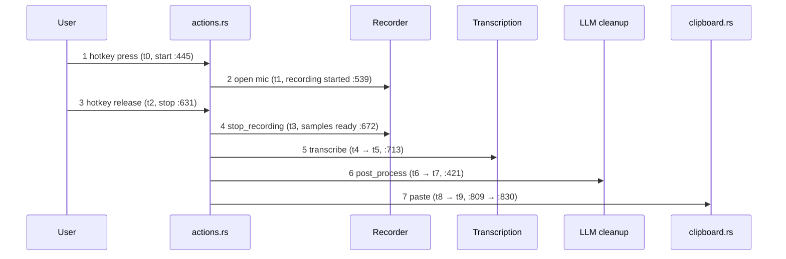

# QA baseline — step 0

Offline accuracy and speed baseline for the fork's ASR models, measured through the
headless `--transcribe-file` CLI. This is the reference later changes are compared against.

## Run summary

| Field        | Value                                                                                                       |
| ------------ | ----------------------------------------------------------------------------------------------------------- |
| Date         | 2026-10-27 21:06 IST                                                                                        |
| Machine      | Apple M3 Max, macOS 26.6.2, Metal backend (`MTL0`)                                                          |
| Binary       | `Handy.app` built from `5f5d13d0` (Architect worktree), `Contents/MacOS/handy` sha256 prefix `3a2dbf383ad8` |
| Harness      | `scripts/qa/bench.py` at `60ecc8cf`                                                                         |
| Corpus       | 40 utterances, 321.9 s audio, 852 reference words (`scripts/qa/corpus.lock`)                                |
| Repeats      | 3 per utterance, plus one discarded warm-up process per model                                               |
| Wall time    | 64 s for both models                                                                                        |
| App settings | `selected_language: auto`, `filler_word_removal_enabled: true`, `custom_words: []`, `translate: false`      |

## Results

| Model                         | Subset     | Utts |   WER |    RTF | p50 ms | p95 ms | First-run p50 / p95 ms | Warm load p50 ms |
| ----------------------------- | ---------- | ---: | ----: | -----: | -----: | -----: | ---------------------: | ---------------: |
| parakeet-unified-en-0.6b-Q8_0 | all        |   40 | 1.76% | 0.0085 |     62 |     99 |               93 / 175 |              260 |
| parakeet-unified-en-0.6b-Q8_0 | test-clean |   30 | 1.71% | 0.0083 |     63 |     99 |               87 / 175 |              260 |
| parakeet-unified-en-0.6b-Q8_0 | test-other |   10 | 1.91% | 0.0091 |     62 |    102 |              113 / 178 |              260 |
| whisper-small-Q8_0            | all        |   40 | 3.87% | 0.0194 |    147 |    208 |              168 / 218 |              161 |
| whisper-small-Q8_0            | test-clean |   30 | 4.04% | 0.0192 |    150 |    212 |              168 / 228 |              161 |
| whisper-small-Q8_0            | test-other |   10 | 3.35% | 0.0202 |    140 |    199 |              161 / 215 |              161 |

Warm-up loads (discarded): Parakeet 315 ms, Whisper Small 191 ms. The ~3.8 s first-ever Metal
shader compile noted in `ARCHITECTURE.md` had already been paid by earlier smoke runs.

**Reading.** Parakeet is about 2.3× faster and makes less than half the errors. Both run far
below real time: an 8 s utterance transcribes in well under 0.2 s. Speed is not the bottleneck
for dictation on this machine; accuracy and the non-ASR stages are.

### Error breakdown

Parakeet made 15 word errors, Whisper Small 33. Roughly half of each are spelling or
normalisation variants rather than misrecognitions:

| Kind                               | Examples (reference → hypothesis)                    | Parakeet | Whisper |
| ---------------------------------- | ---------------------------------------------------- | -------: | ------: |
| UK/archaic spelling in LibriSpeech | coloured → colored, befal → befall, hollan → holland |        6 |       6 |
| Contraction / abbreviation         | i am → I'm, mister → Mr                              |        2 |       3 |
| Number formatting                  | eighteen fifty five → 1855                           |        0 |       3 |
| Word joining                       | to day → today, neo platonists → neoplatonists       |        0 |       5 |
| Genuine misrecognition             | wool → wolves, formidable → formable, deigned → dane |        7 |      16 |

Per-utterance hypotheses are in `.qa-results/<model>/results.json` after a run.

## Re-running

```bash
source ~/.cargo/env; export PATH="$HOME/.bun/bin:$PATH"; export HANDY_DISABLE_UPDATER=1

# 1. Corpus (stdlib Python + afconvert; ffmpeg fallback). Verifies against corpus.lock.
scripts/qa/fetch-corpus.sh

# 2. Models, pinned to the catalog revisions, into the HF cache the app reads.
hf download handy-computer/parakeet-unified-en-0.6b-gguf parakeet-unified-en-0.6b-Q8_0.gguf \
  --revision 7e948f21b7bdbac698d3318db9d350f1096f3b6c
hf download handy-computer/whisper-small-gguf whisper-small-Q8_0.gguf \
  --revision c0214bd34be9296695486f838e0142f900803159

# 3. Benchmark. HANDY_APP defaults to this repo's release bundle.
HANDY_APP=/path/to/Handy.app scripts/qa/bench.sh --repeat 3 \
  handy-computer/parakeet-unified-en-0.6b-gguf/parakeet-unified-en-0.6b-Q8_0.gguf \
  handy-computer/whisper-small-gguf/whisper-small-Q8_0.gguf
```

Outputs land in `.qa-results/` (gitignored): `summary.md`, and per model `results.json`,
`summary.md`, `cli.log`. Add `--limit N` for a quick smoke run.

Model file sha256 (match `src-tauri/src/catalog/catalog.json`):

- `parakeet-unified-en-0.6b-Q8_0.gguf` `4b50b6dd862bf6e346929aaf4f5eaacec003bfa3f56462d6c874b41ef2f38795`
- `whisper-small-Q8_0.gguf` `9b9c8811bbcc82a7766f0fb0925614bdacb0923b2cc630daeac17108b655b860`

Model ids for the CLI are `repo/filename`, not the catalog `id`. Passing `whisper-small` fails
with "Model not found".

## Corpus

LibriSpeech (Panayotov et al., 2015), [openslr.org/12](https://www.openslr.org/12), CC BY 4.0.

- **test-clean:** 10 speakers × 3 utterances.
- **test-other:** 5 speakers × 2 utterances (harder acoustics).
- One chapter per speaker, 8–40 words per utterance, chosen deterministically.
- Converted from FLAC to 16 kHz mono 16-bit WAV.
- `corpus.lock` pins each utterance id with a sha256 of its decoded PCM, so a re-fetch is
  verified byte-for-byte regardless of encoder header differences.

Audio stays in `.qa-corpus/` and is never committed.

## Metric definitions

- **WER:** word edit distance ÷ reference words, pooled over the subset. Both sides are
  lowercased, apostrophes are removed, and other non-alphanumerics become spaces. Numbers and
  spelling variants are not normalised, which inflates WER (see the breakdown above).
- **Latency:** per utterance, the median of `--repeat` inference times (`transcribe_ms`). p50
  and p95 are nearest-rank over utterances. "First-run" uses each process's first inference only.
- **RTF:** sum of per-utterance median latency ÷ total audio seconds. Lower is faster. The CLI's
  own `rtf` field is the inverse (audio ÷ best time); the harness does not use it.
- **Warm load:** `load_ms` of measured processes, after one discarded warm-up process.

Caveats:

- `TranscriptionManager::transcribe` (`src-tauri/src/managers/transcription.rs:927`) applies
  the live app settings, including filler-word removal. Settings are recorded in `results.json`.
- Whisper ran with language `auto`. Forcing `en` may change both WER and latency slightly.
- One process per utterance means a fresh model load each time; the app keeps the model
  resident, so `load_ms` only matters after an idle unload (`model_unload_timeout`, 5 min).

## What the CLI does not measure

The CLI times model load and inference on a file. A real dictation also includes:

| Stage                        | Why the CLI misses it                          | Existing signal                                                                     |
| ---------------------------- | ---------------------------------------------- | ----------------------------------------------------------------------------------- |
| Hotkey press → mic open      | No shortcut, no device open                    | debug timings in `TranscribeAction::start` (`actions.rs:445-618`)                   |
| Hotkey release → samples     | No recorder; VAD trim and stream drain skipped | debug `stop_recording` time (`actions.rs:671-678`)                                  |
| Live/streaming transcription | File is fed whole                              | none                                                                                |
| AI cleanup (LLM)             | `post_process` never runs in headless mode     | **none**                                                                            |
| Paste into target app        | No clipboard or keystroke simulation           | debug paste time (`actions.rs:809`, `:825-830`)                                     |
| Release → text visible       | Sum of the above                               | `TranscriptionCompleteEvent.wait_seconds` (`actions.rs:47-67`), emitted, not logged |

The existing signals are scattered `debug!` lines with no shared session id, so they cannot be
joined into a per-dictation breakdown, and the LLM step is not timed at all.

### Step-1 proposal (not implemented)

Add one fork-owned module, e.g. `src-tauri/src/flow/timing.rs`, holding a per-session
`FlowTimer` keyed by the existing recording generation. Upstream files get one-line `mark()`
calls only, which keeps merge conflicts small.



| Mark  | Location                                              | Derived metric                       |
| ----- | ----------------------------------------------------- | ------------------------------------ |
| t0    | `TranscribeAction::start` entry, `actions.rs:445`     | —                                    |
| t1    | recording started, `actions.rs:539`                   | press → mic open                     |
| t2    | `TranscribeAction::stop` entry, `actions.rs:631`      | —                                    |
| t3    | samples returned, `actions.rs:672`                    | release → audio ready                |
| t4/t5 | around transcription, `actions.rs:713`                | ASR time (should match CLI)          |
| t6/t7 | around `post_process_transcription`, `actions.rs:421` | LLM cleanup time                     |
| t8/t9 | around `utils::paste`, `actions.rs:809-830`           | paste time                           |
| —     | t9 − t2                                               | **release → text pasted** (headline) |

Emit one `info!` JSON line per dictation (`flow_timing {...}`) with the deltas, audio seconds,
model id, and whether cleanup ran. A small `scripts/qa/flow_report.py` would then parse
`handy.log` into p50/p95 per stage. For a repeatable end-to-end run without a human, play a
corpus WAV through a loopback input (e.g. BlackHole, if installed) while triggering
`--toggle-transcription` from a script, and paste into a TextEdit document. What we can and
cannot automate there is a step-1 decision.

Rough targets to validate in step 1: release → pasted under 500 ms without cleanup, and the
LLM step reported separately so it can be budgeted on its own.

## Watch items

- **Flaky test:** `clipboard::tests::external_script_does_not_wait_for_inherited_stdio`
  (`src-tauri/src/clipboard.rs:1012-1048`) asserts via a 1 s `recv_timeout` (`:1044`) and fails
  under parallel `cargo test` load. Not modified. If it fails in CI, re-run it alone
  (`cargo test external_script_does_not_wait`) before treating it as a regression.
- **Spelling variants:** about half of measured WER is UK/US spelling, numbers, and
  contractions. If we start comparing models closely, add a normaliser (e.g. Whisper's English
  text normaliser rules) rather than chasing those errors.

## Scope notes

- **Whisper Large v3 Turbo** (886 MB) was not benchmarked. Hugging Face downloads stalled for
  most of the session, so only the two required models were installed. Turbo is the next model
  to add.
- **Corpus download:** the first full-tarball stream timed out after 52 minutes. The fetcher was
  made resumable and switched to the fastest mirror; the second run finished test-other in 40 s.
- **Whisper Small download:** stalled at 14 MB on the first attempt and finished on a retry.
- The binary is the Architect's build at `5f5d13d0`, not rebuilt from this branch. This branch
  changes no app source, so the results apply to it.
